

  <a href="https://samuel-rigaux.github.io">
    
  </a>

  

  

  

Hi there! I'm **Samuel**, a 26-year-old cybersecurity student at **La Plateforme** in Marseille, on a work-study program at **Softway Medical** as an integration & support technician.

I'm also an independent beatmaker, releasing music as **D SAM**, and I shoot photos whenever I travel. I'm used to learning by myself and I love discovering new things. Two worlds, one mindset: break it down, understand it, rebuild it better.

| | |
|:--|:--|
| **Location** | Marseille, France |
| **Studying** | Bachelor IT — Cybersecurity, La Plateforme (2024 – 2027) |
| **Working** | Integration & support technician, Softway Medical |
| **Portfolio** | [samuel-rigaux.github.io](https://samuel-rigaux.github.io) |
| **Off the clock** | Photography, travel, sports cars, gaming, anime, basketball |

  

- **Currently working on Nessus** — vulnerability scanning, and learning to read, prioritize and report findings
- **Virtualization** — nested labs and VM migrations between type 1 hypervisors (ESXi, Hyper-V, Proxmox VE, XCP-ng)
- **Containers & orchestration** — Docker, Docker Swarm (HA cluster with NFS storage), K3S / Kubernetes with Helm
- **Infrastructure as Code** — Terraform to deploy attacker/victim VM labs, Ansible for hardening, Suricata, Filebeat and Vault
- **Identity & compliance** — Microsoft Entra ID (PowerShell, Graph, SAML SSO) and a GDPR audit with the CNIL PIA tool
- **Networking** — DHCP, SSH, FTP, LDAP, VoIP, Wireshark, Linux administration
- **Hardware** — learning to build PCs from the ground up

  

When I'm not in a terminal, I'm in **FL Studio**. My music is released as **D SAM** and available on all streaming platforms.

<table>
  <tr>
    <td align="center" width="25%"> <b>With you</b></td>
    <td align="center" width="25%"> <b>RAINY DAY</b></td>
    <td align="center" width="25%"> <b>Garden</b></td>
    <td align="center" width="25%"> <b>HEYSAM UNFINISHED</b></td>
  </tr>
</table>

**[Magic Sounds](https://github.com/samuel-rigaux/magic-sounds)** is my own VST3 plugin for FL Studio: gate, distortion and compression in three knobs. This is where my two worlds meet — sound design and code.

  
  

  

  

  

  
  
  
  
  
  
  
  

  

<table>
  <tr>
    <td align="center" width="25%"> <b><a href="https://samuel-rigaux.github.io/Projet-site/">Fan site</a></b> A fan site about Damso</td>
    <td align="center" width="25%"> <b><a href="https://github.com/samuel-rigaux/NexusVirtualis">Nexus Virtualis</a></b> View on GitHub</td>
    <td align="center" width="25%"> <b><a href="https://github.com/samuel-rigaux/docker">Docker</a></b> View on GitHub</td>
    <td align="center" width="25%"> <b><a href="https://samuel-rigaux.github.io">Portfolio</a></b> My resume website</td>
  </tr>
</table>

  

I love travelling and taking pictures, and I never retouch them. Each image is a moment exactly as I saw it.

<table>
  <tr>
    <td align="center" width="33%"> <b>Colorful car park</b> Marseille · January 24, 2023</td>
    <td align="center" width="33%"> <b>Beauduc beach</b> Beauduc · July 17, 2017</td>
    <td align="center" width="33%"> <b>Étang de Berre</b> Martigues · December 13, 2021</td>
  </tr>
</table>

  

  Feel free to reach out for any collaboration or question.

  
  
  
  

  

