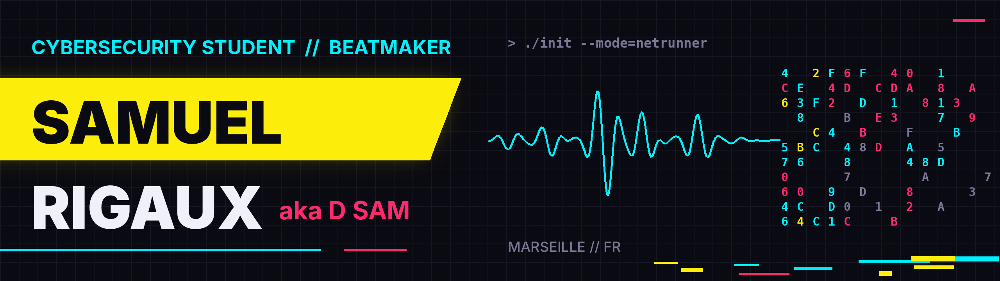
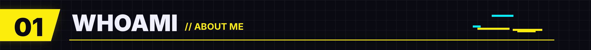
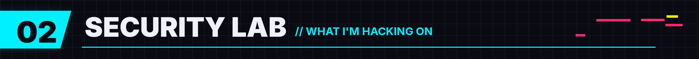
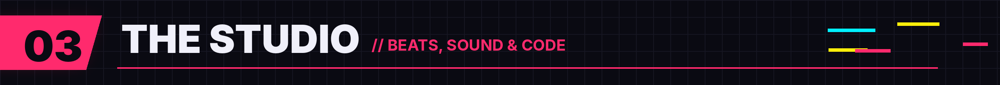
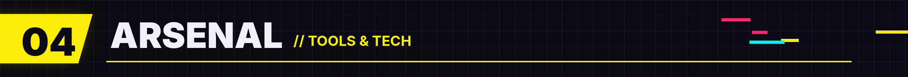
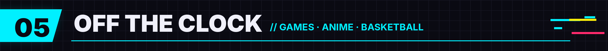
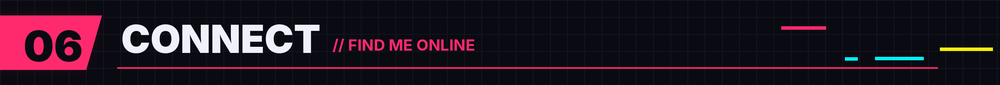

<p align="center">
  
</p>

<p align="center">
  
</p>

<p align="center">
  
</p>

```bash
$ whoami
samuel_rigaux  # aka D SAM

$ cat about.txt
> 26 y/o cybersecurity student @ La Plateforme — Marseille, FR
> Work-study at Softway Medical
> Independent artist & beatmaker, streaming everywhere as D SAM
> Two worlds, one mindset: break it down, understand it, rebuild it better.
```

<p align="center">
  
</p>

- 🖥️ **Nested virtualization**: building VMs inside VMs to simulate full networks
- 🐳 **Docker**: containerizing services and isolating environments
- 🔧 **Hardware**: learning to build PCs from the ground up
- 🌐 **Networking**: DHCP, SSH, FTP, VoIP, Linux administration

<p align="center">
  
</p>

When I'm not in a terminal, I'm in **FL Studio**.

🎧 Music released as **D SAM**, available on all streaming platforms.

🎛️ **[Magic Sounds](https://github.com/samuel-rigaux/magic-sounds)**: my own VST3 plugin for FL Studio. Gate, distortion and compression in three knobs, wrapped in a Cyberpunk-style interface. This is where my two worlds meet: sound design and code.

<p align="center">
  <a href="https://github.com/samuel-rigaux/magic-sounds">
    
  </a>
</p>

<p align="center">
  
</p>

<p align="center">
  
</p>

<p align="center">
  
  
  
  
  
</p>

<p align="center">
  
</p>

| 🎮 Gaming | 🌸 Anime | 🏀 Basketball | 🌃 Night City |
|:---:|:---:|:---:|:---:|
| Always one more run | Binge-watcher | Hooper at heart | Cyberpunk 2077 forever |

<p align="center">
  
</p>

<p align="center">
  <a href="https://www.linkedin.com/in/samuel-rigaux/">
    
  </a>
  
  <a href="https://open.spotify.com/intl-fr/artist/4QNbMNES0Aw41OQN2vjjjx?si=aZcwux3SRUqAoHIXcANvpw">
    
  </a>
</p>

<p align="center"><sub>// connection terminated — see you in Night City</sub></p>
